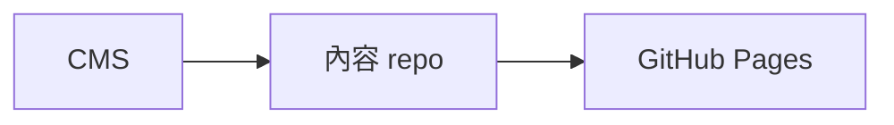

# CMS

Admin UI for the local CMS: article list with the Pending Deletion area, a split Markdown editor with live preview and Auto Save, and the 網站與關於 page form for the site name, description and About page (saved with an explicit 儲存 button). FastAPI serves the build at `/admin/` (see `backend/README.md`).

```sh
npm ci
npm test         # draft sync, tag parsing and the profile form
npm run build    # typecheck, then write dist/
npm run dev      # Vite dev server; proxies /api to 127.0.0.1:8000
```

`src/draft-sync.ts` owns the Auto Save and Publish protocol (ART-021): one request at a time, each carrying the revision the previous one returned. A 409 stops Auto Save until the author reloads.

## 文章語法

文章用 Markdown 撰寫，不能放原始 HTML（會顯示成文字）。除了一般語法，還可以用以下三種，寫法與 GitHub 相同，預覽會照網站的樣子顯示。

**註腳**：在文字後面加 `[^名稱]`，再在任何地方寫一行 `[^名稱]: 註腳內容`。註腳依第一次出現的順序編號，顯示在文末的「註腳」區塊。內容要換行時，後面每一行縮排 4 個空格。

```markdown
GitHub Pages 只提供靜態檔案[^pages]。

[^pages]: 也不能設定回應標頭。
```

**提示框**：引言的第一行寫 `[!NOTE]`（注意）、`[!TIP]`（提示）、`[!IMPORTANT]`（重要）、`[!WARNING]`（警告）或 `[!CAUTION]`（小心），這一行不能有其他文字。其他寫法維持一般引言。

```markdown
> [!WARNING]
> 部署到子路徑時要設定 basePath。
```

**Mermaid 圖表**：語言寫 `mermaid` 的程式碼區塊會變成圖表，網站在建置時就畫好，讀者不需要下載 Mermaid。加一行 `%% title: 圖表說明` 當作螢幕閱讀器讀出的名稱。語法錯誤時預覽會顯示錯誤訊息，這時發布的網站更新會建置失敗，網站維持原樣，修正後再更新一次即可。

````markdown

````
