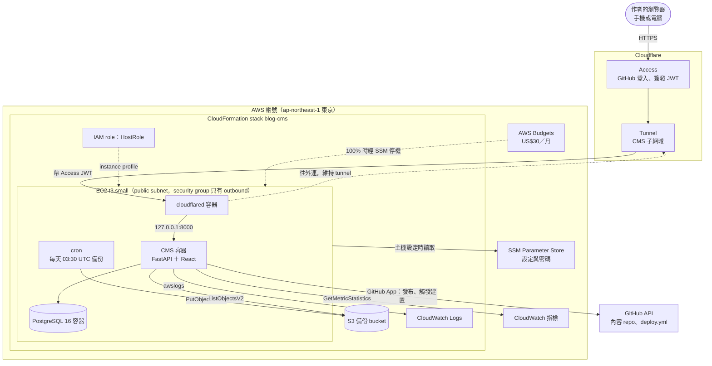
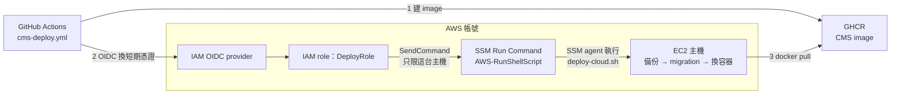

# AWS 資源與架構

作者的雲端 CMS 在 AWS 上用到的全部資源，以及它們和 GitHub、Cloudflare 之間的連線。內容以 2026-11-01 的 `main` 為準，來源是 [`infra/aws/cms-ec2.yaml`](../../infra/aws/cms-ec2.yaml)、[`docs/cloud-ec2.md`](../cloud-ec2.md) 與 [`docs/maintainer-notes.md`](../maintainer-notes.md)。2026-11-01 已用文末的指令對照過 AWS 帳號，資源與設定都和這份文件相符。

公開網站（GitHub Pages ＋ Cloudflare）不使用任何 AWS 資源。AWS 只負責 CMS：主機停止時 CMS 無法使用，讀者不受影響。

## 架構圖

主機沒有任何 inbound 規則。作者的連線與 GitHub Actions 的部署指令，都靠主機自己往外連（`cloudflared`、SSM agent）才送得進來。實線是資料或指令的流向，虛線是權限或控制關係。

### 執行期：作者使用 CMS



### 部署：推 `cms-v*` tag



## 資源清單

### CloudFormation stack 管理的資源

用 `infra/aws/cms-ec2.yaml` 建立，stack 名稱 `blog-cms`。改這些資源要改 template，再用 change set 套用（[`cloud-ec2.md`](../cloud-ec2.md) 第 4 節）。

| 資源 | Template 裡的名稱 | 用途與限制 |
| --- | --- | --- |
| EC2 instance | `Host` | 跑 CMS、PostgreSQL、`cloudflared` 三個容器。`t3.small`、Amazon Linux 2023、20 GB gp3 加密。IMDSv2 必填、hop limit 1，所以 bridge network 的 PostgreSQL 拿不到 instance role 憑證。`ImageId` 固定，stack 更新不會換主機；換主機時舊主機保留（`UpdateReplacePolicy: Retain`） |
| Security group | `HostSecurityGroup` | 只有 outbound（套件更新、拉 image、SSM、S3、Cloudflare Tunnel），沒有 inbound |
| IAM role ＋ instance profile | `HostRole`、`HostInstanceProfile` | `AmazonSSMManagedInstanceCore`；讀 `/blog/cms` 底下的參數與三個多行密碼；備份 bucket 只能列出與寫入 `cms/`，不能讀或刪；寫 log group；讀 CloudWatch 指標 |
| S3 bucket | `BackupBucket`、`BackupBucketPolicy` | 備份。封鎖公開存取、SSE-S3 加密、版本控制、90 天到期、只接受 HTTPS。刪 stack 時保留 |
| CloudWatch log group | `LogGroup` | CMS 容器的 log（Docker `awslogs` driver），保留 30 天 |
| IAM OIDC provider | `GitHubOidcProvider` | 讓 GitHub Actions 不用長期金鑰就能取得 AWS 憑證。帳號裡已經有時用參數關掉 |
| IAM role | `DeployRole` | 只能被 `cms-production` environment 的 workflow assume；只能對這台主機送 `AWS-RunShellScript`、讀執行結果 |

### Stack 以外、手動建立的資源

| 資源 | 內容 |
| --- | --- |
| SSM Parameter Store（SecureString） | `/blog/cms/*`：CMS 的環境變數，主機設定腳本據此產生 `/srv/blog/cms.env`。`/blog/cloudflared-token`：tunnel token。`/blog/cms-github-app-pem`、`/blog/cms-gsc-credentials`：GitHub App 私鑰與 Search Console 服務帳戶金鑰，主機設定腳本寫成 `/srv/blog/secrets/` 底下的檔案。參數清單見 [`cloud-ec2.md`](../cloud-ec2.md) 第 3 節 |
| AWS Budgets `blog-monthly` | 每月 US$30。Budget action 的類型是 Run SSM documents → Stop EC2 instances：實際花費達 100% 時自動執行（不需要核准），經 SSM 停止 EC2 主機。執行 action 用的 IAM role 也是手動建立 |
| VPC 與 subnet | 用帳號的預設 VPC 與一個 public subnet，以 stack 參數傳入。主機拿到的 public IPv4 只用來往外連 |

### 用到但不需要建立的 AWS 服務

- **SSM Run Command**：部署時 GitHub Actions 透過 `DeployRole` 呼叫，用 AWS 內建的 `AWS-RunShellScript` document。
- **CloudWatch 指標**：EC2 自動產生的 CPU、網路、狀態檢查，CMS 用免費的 `GetMetricStatistics` 讀取，記憶體快取 5 分鐘。
- **STS**：GitHub Actions 用 `AssumeRoleWithWebIdentity` 換短期憑證；主機透過 instance profile 自動取得憑證。

## 主要流程

| 流程 | 經過的資源 |
| --- | --- |
| 作者使用 CMS | 瀏覽器 → Cloudflare Access（GitHub 登入）→ Tunnel → `cloudflared` → CMS（驗證 Access JWT）→ PostgreSQL |
| 部署 CMS | 推 `cms-v*` tag → `cms-deploy.yml` 建 image 推到 GHCR → OIDC 換 `DeployRole` 憑證 → SSM Run Command → 主機上 `deploy-cloud.sh`：先備份、再 migration、最後換容器 |
| 每日備份 | 主機 cron 03:30（UTC）→ `/srv/blog/backups` → `aws s3 sync` 到 bucket 的 `cms/`。每次部署前也會備份 |
| 發布文章 | CMS → GitHub API（GitHub App）寫內容 repo、觸發 `deploy.yml`。這一步不經過 AWS |
| 費用上限 | AWS Budgets 實際花費達 100% → budget action 經 SSM 停止 EC2 |

## 憑證

AWS 這一側沒有長期存取金鑰：

- GitHub Actions：OIDC 換短期憑證，只能 assume `DeployRole`。
- 主機：instance profile 的短期憑證。
- 作者本機：`aws login`（瀏覽器登入、短期憑證），沒有 access key。

## 費用（粗估）

`t3.small` 約 US$15、20 GB gp3 約 US$2、public IPv4 約 US$4，S3、CloudWatch Logs 與 SSM 合計通常不到 US$1。每月約 US$20，預算上限 US$30。

## 對照實際帳號

2026-11-01 的對照結果：stack 的 9 個資源都是 `CREATE_COMPLETE` 或 `UPDATE_COMPLETE`；SSM 的 23 個參數都在上面列的路徑下；EC2、磁碟、IMDS、預設 VPC、log 保留 30 天、備份 90 天到期與版本控制都和 template 相同；第一份排程備份（03:30 UTC）已出現在 bucket。

之後要再確認時，先 `aws login`，再執行：

```sh
aws cloudformation describe-stack-resources --region ap-northeast-1 --stack-name blog-cms \
  --query 'StackResources[].[LogicalResourceId,ResourceType,ResourceStatus]' --output table
aws ssm get-parameters-by-path --region ap-northeast-1 --path /blog --recursive --query 'Parameters[].Name'
aws budgets describe-budget-actions-for-account --account-id "$(aws sts get-caller-identity --query Account --output text)"
```

改了 template、新增 stack 以外的資源，或拿掉某個資源時，要一起更新這份文件。
