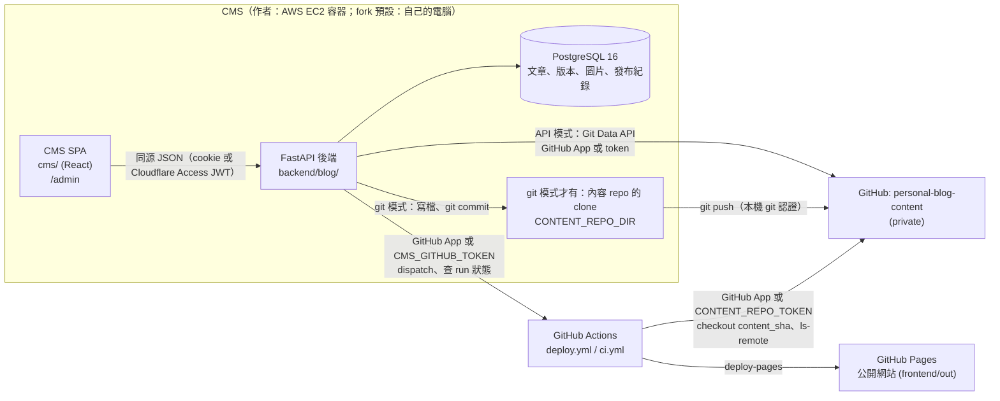
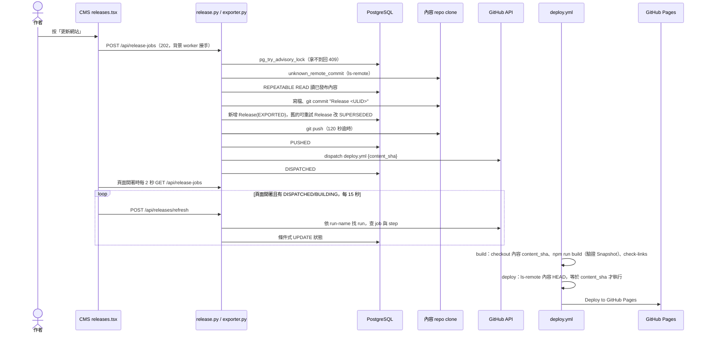
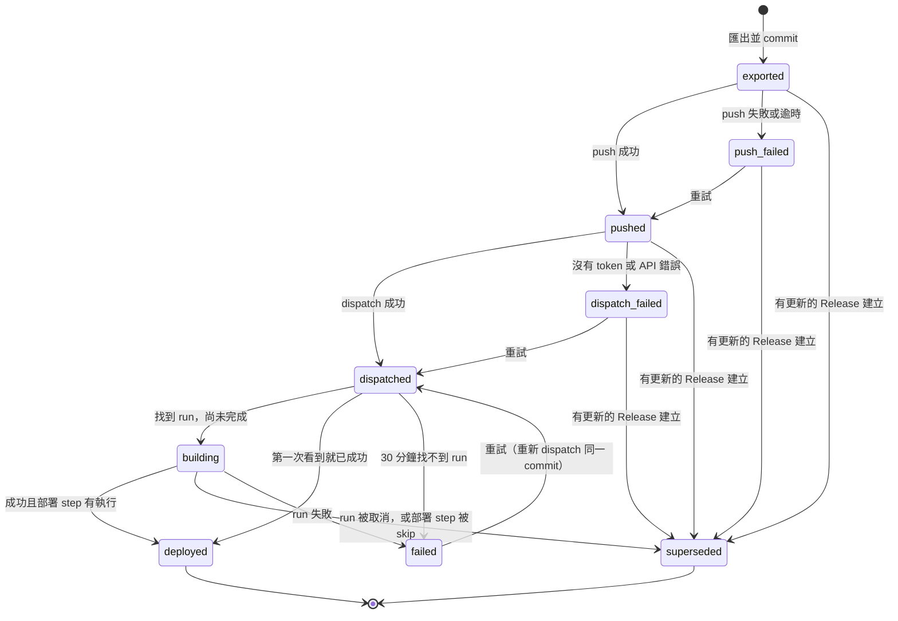

# 系統如何運作：架構導覽

> **這是導覽，不是規格。** 給要改程式的人快速建立心智模型。設計決策與理由在 [`docs/design/`](../design/)；本機操作在 [`local-setup.md`](../local-setup.md)，雲端 CMS 在 [`cloud-ec2.md`](../cloud-ec2.md)、[`cloud-tailscale.md`](../cloud-tailscale.md) 與 [`cms-deployment.md`](../cms-deployment.md)。內容以 2026-10-27 的程式碼為準，雲端 CMS、GitHub 認證與檔案位置的段落更新到 2026-10-31。行為有出入時以程式碼為準。

## 本機與雲端共用發布流程

目前 CMS 可透過 CONTENT_TRANSPORT 選擇 git clone 或 Git Data API，並以 PAT 或 GitHub App 認證。「更新網站」先建立持久背景工作並回應 202；worker 匯出一致的 Snapshot，先保存 commit、parent 與內容及部署目的地，再更新遠端分支。重新開啟發布頁會讀回工作狀態。下面提到 clone、Git push 與同步呼叫的段落描述保留的 git 相容模式；CMS 介面使用新的背景工作 API。

API 模式不需要本機 clone 或 Git 身分。工作開始時才擷取當時已發布內容；commit 已準備完成的工作則在重試時接續同一份內容。詳細設定與中斷處理見 [本機與雲端設定](../portable-cms.md)，決策見 Addendum 03 BE-022。

## 1. 概觀

這個專案由五個部分組成。作者在 CMS 寫文章，資料存在 PostgreSQL。作者的 CMS 跑在 AWS EC2 的容器裡，經 Cloudflare Tunnel 與 Access 連線（`docs/cloud-ec2.md`）；fork 預設在自己的電腦上執行（`docs/local-setup.md`），也可以照 `docs/cloud-tailscale.md` 放到雲端。按「更新網站」時，後端把所有已發布內容匯出成一份 JSON Snapshot，寫進 private 內容 repo `Hack-Ray/personal-blog-content`（GitHub API，或本機 clone 的 git push），再呼叫 GitHub Actions 的 `deploy.yml`。workflow 把這份 Snapshot 交給 Next.js 建置成純靜態網站，部署到 GitHub Pages。

公開網站在執行期不依賴後端或資料庫。後端只在作者寫作與發布時需要開著。兩邊唯一的介面是內容 repo 裡的 Snapshot 檔案，格式由 `frontend/src/content/parse.ts` 定義。



GitHub 認證有兩種，每一邊各選一種：

| 誰 | GitHub App（作者使用） | Personal token（fork 預設） | 用途 |
|---|---|---|---|
| 後端 | `GITHUB_AUTH=app` 與 `GITHUB_APP_*`。後端自己換短效 installation token | `CMS_GITHUB_TOKEN`，放在後端 `.env`。部署 repo 的 Actions 讀寫；API 模式另需內容 repo 的 Contents 讀寫 | dispatch `deploy.yml`、查 run 與 job 狀態、API 模式寫入內容 repo。token 模式另讀自己的到期日 |
| `deploy.yml` | Actions variable `APP_CLIENT_ID` 與 secret `APP_PRIVATE_KEY`，以 `actions/create-github-app-token` 取得內容 repo 的唯讀 token | Actions secret `CONTENT_REPO_TOKEN`，內容 repo 的 Contents 唯讀 | build 時 checkout 內容、deploy 前 `ls-remote`。token 模式另由 `token-expiry.yml` 檢查到期 |

git 模式 push 到內容 repo 不用上面的認證，用的是本機 git 的認證（SSH key 或 `gh auth`）。

## 2. 重要概念

- **Article／`doc_id`**：一篇文章。`doc_id` 是大寫 ULID，建立時產生，終身不變。沒有設定 slug 時，公開網址是 `/posts/<doc_id>/`。永久刪除後 `doc_id` 進入 `retired_doc_ids`，不會再發出。
- **Slug 與文章網址**：作者可以替文章設定英文 slug（`articles.slug`，小寫英數與 `-`，最多 80 字，`page` 保留），公開網址變成 `/posts/<slug>/`。slug 和置頂一樣不進版本，下一次「更新網站」才生效，不需要重新發布。`article_urls` 記錄文章實際匯出過的每個網址片段（`doc_id` 或 slug），換網址後舊片段成為轉址頁。另一篇文章目前使用、或曾以它匯出過的 slug 都不能再用；只在 CMS 打錯、還沒匯出過的 slug 會釋出。
- **Working Draft 與 revision**：每篇文章恰好一份草稿（`working_drafts`，以 `article_id` 為 PK）。每次寫入 revision +1。所有寫入都帶 `base_revision`，不符就 409。這是整個 CMS 的樂觀鎖。
- **Published Version**：按「發布」時把草稿完整複製一份，版本號 1、2、3 遞增。只能新增，trigger 拒絕 `UPDATE`（例外見 Gotchas）。
- **Draft Snapshot**：自動儲存覆蓋前保留的舊 Markdown，每篇最多 50 份，發布時全部刪除。只是草稿的復原點，與 Content Snapshot 無關。
- **Taxon**：Topic、Tag、Series 的統稱，以 `{slug, name}` 表示。Topic 必填一個，Series 選填一個，Tags 多個。slug 不存在時自動建立。
- **Image id**：`<WebP 內容的 sha256>.webp`。上傳的圖一律轉成 WebP 再算雜湊，相同內容得到相同 id。Markdown 中只有 `images/<id>` 這種寫法算引用。圖片位元組存在 Postgres 的 `image_data`。
- **Content Snapshot**：匯出到內容 repo 的檔案集合：`manifest.json`、`profile.json`、`articles/<doc_id>.json`、`images/`。公開網站唯一的資料來源。
- **Release**：一次「更新網站」。id 是該次 manifest 的 `release_id`（ULID，所以按 id 排序就是時間順序）。記錄內容 repo 的 commit、狀態與 GitHub run。`release_articles` 記錄這次包含哪些 `(article_id, version)`。
- **「發布」與「更新網站」**：兩件不同的事。「發布」只在資料庫建立新的 Published Version，網站不變。「更新網站」把**所有**已發布文章的最新版本與封存清單一起匯出並部署。CMS 發布成功後的訊息會提醒這點。

## 3. 運作方式

### 3.1 請求如何進到後端

後端是單一 ASGI app，`backend/blog/api.py` 的 `app`。它提供：

- `/api/*`：JSON API。
- `/healthz`：`SELECT 1`。
- `/admin`：建置好的 CMS SPA（`StaticFiles(html=True)`，來源 `CMS_DIST`，預設 `../cms/dist`）。只在 import 時目錄存在才掛載。
- `/`：轉址到 `/admin/`。

設定由 `config.py` 的 `load()` 在 import 時讀一次，存成 frozen dataclass `config.settings`。`CMS_ENV=local`（預設）或 `cloud` 只決定預設值：`cloud` 必須設定 `DATABASE_URL`、`ALLOWED_HOSTS`、`CMS_ORIGIN`，並預設 `COOKIE_SECURE=1`、`ENABLE_DOCS=0`。格式錯誤丟 `ConfigError`，`ALLOWED_HOSTS='*'` 會被拒絕。`db.py` 在 import 時建立 engine。

Starlette 依註冊順序的**反向**執行 middleware。`api.py` 依序註冊 `require_admin`、`security_headers`、`trusted_host`，所以請求經過的順序是：

1. **`trusted_host`**：`Host` 不在 `ALLOWED_HOSTS` 回 400。`/healthz` 例外。用來擋 DNS rebinding。
2. **`security_headers`**：回應時對 `/admin*`、`/api/*`、`/` 加上 CSP（`script-src 'self'`、`frame-ancestors 'none'` 等）、`nosniff`、`Referrer-Policy: same-origin`，`COOKIE_SECURE` 時加 HSTS。也替不安全方法的 `/api` 呼叫寫一行 `blog.audit` log。
3. **`require_admin`**：只管 `/api/*`。不安全方法（POST/PUT/PATCH/DELETE）帶了 `Origin` 而且不等於 `CMS_ORIGIN`（未設定時用請求本身的 scheme://netloc）回 403。除了 `/api/session`，其他路徑都要 `auth.is_signed_in()` 通過，否則回 401。這個檢查在 threadpool 裡用自己的 `SessionLocal` 跑。
4. **路由函式**：拿到 `SessionDep` 與 Pydantic body。例如 `DraftBody.content()` 轉成 `articles.DraftContent`，再交給領域模組。

驗證是 middleware 不是 `Depends`，新增路由不用另外加驗證，也無法對單一路由豁免（除非改 `PUBLIC_API`）。

領域例外由 `api.py` 統一對應成 HTTP：

| 例外 | HTTP | 回應附帶 |
|---|---|---|
| `ArticleNotFound`、`TaxonNotFound` | 404 | |
| `RevisionConflict` | 409 | `current_revision` |
| `InvalidTransition` | 409 | `state` |
| `ProfileConflict` | 409 | |
| `TaxonInUse` | 409 | |
| `ExportError`、`ReleaseError`（含 `ReleaseBusy`） | 409 | |
| `NotPublishable`、`InvalidMerge` | 422 | |
| `ImageTooLarge` | 413 | |
| `UnsupportedImage` | 415 | |
| 登入被鎖 `TooManyAttempts` | 429 | `Retry-After` |
| scrypt 忙碌 | 503 | |
| `CONTENT_REPO_DIR` 不是 git clone | 503 | |
| 讀 GitHub token 到期日失敗 | 502 | |

**登入**（`auth.py`）：密碼以 scrypt（N=2^15，約 32 MiB）存在 `admin_credentials` 唯一一列。`sign_in` 先依 `request.client.host` 計失敗次數，先加一再驗密碼。5 次以上失敗後鎖定 `min(15 分鐘, 30 秒 × 2^(n−5))`。scrypt 外面有每個 process 2 個名額的 semaphore，等 10 秒拿不到回 503。成功後刪掉失敗紀錄與過期 session，建立 `admin_sessions`（只存 token 的 sha256）。cookie 為 httponly、`SameSite=Strict`、3 天；`COOKIE_SECURE` 時名稱是 `__Host-cms_session`，否則 `cms_session`。閒置超過 1 天也失效，`last_seen_at` 最多每 5 分鐘寫一次。`set_password` 會登出所有 session。CLI：`python -m blog.auth`。

**Cloudflare Access 登入**（`cloudflare_access.py`，BE-026）：三個 `CLOUDFLARE_ACCESS_*` 都設定時，上面的密碼登入整個關閉。`require_cloudflare_access` middleware 對 `/healthz` 以外的每個請求驗證 `Cf-Access-Jwt-Assertion`：只收 RS256，檢查 AUD、issuer、`exp`、`iat`（60 秒誤差），email 要在白名單。公鑰以 `PyJWKClient` 從 team domain 取得並依 kid 快取。驗證失敗回 403，取不到公鑰回 503。通過時 email 放在 `request.state.access_email`，`require_admin` 以它判斷已登入，忽略 cookie。

### 3.2 文章的生命週期

所有寫入都經過 `articles._locked(doc_id, action)`：`SELECT ... FOR UPDATE` 鎖住文章列，檢查 `ALLOWED_FROM[action]`，不允許就丟 `InvalidTransition`（409）。

| 動作 | 允許的起始狀態 | 結果狀態 | 函式 |
|---|---|---|---|
| EDIT（自動儲存、還原快照、置頂、slug） | draft、published、archived | 不變 | `save_draft`、`restore_snapshot`、`set_pinned`、`set_slug` |
| PUBLISH | draft、published、archived | published | `publish` |
| ARCHIVE | 只有 published | archived | `archive` |
| DELETE（軟刪除） | draft、published、archived | pending_deletion，記下 `state_before_deletion`、`deleted_at` | `delete` |
| RESTORE | pending_deletion | 回到 `state_before_deletion` | `restore` |
| PURGE（手動，或滿 30 天由維護工作執行） | pending_deletion | 整列刪除，`doc_id` 進 `retired_doc_ids` | `purge`、`purge_expired` |

PURGE 靠 `ON DELETE CASCADE` 一起刪掉草稿、版本、快照、`release_articles` 與 `article_urls`，所以該文章用過的 slug 會釋出。

沒有「已發布但有未發布修改」這個狀態。編輯已發布文章時 state 仍是 published，草稿只是領先最新版本。匯出永遠用最新的 Published Version，不看草稿。

**建立**：`create_article` 產生不在 `retired_doc_ids` 中的 ULID，建立 draft 狀態的 Article 與 revision 1 的草稿。

**自動儲存**（`save_draft`）：

1. 鎖定，比對 `base_revision`，不符丟 `RevisionConflict`。
2. `_snapshot_before_overwrite`：Markdown 有變時，在這個編輯週期的第一次、之後最多每 10 分鐘一次、或長度變化 500 字以上時，保留舊內容為 Draft Snapshot。超過 50 份刪最舊的。
3. `_apply` 寫入欄位。Taxon 由 `_get_or_create` 以 `INSERT ... ON CONFLICT (slug) DO UPDATE name` 取得，所以**最後儲存的名稱在所有地方生效**。接著 `images.mark_referenced`。
4. revision +1。

**發布**（`publish`）：請求帶的是作者畫面上的完整內容，不是讀資料庫裡的草稿。

1. 驗證：標題與 Markdown 非空白；cover 必須是文章內引用的圖；所有引用的圖都存在；連結與圖片網址符合網址政策（`url_policy.blocked`）。否則 422。
2. 鎖定並比對 revision，`_apply`，revision +1，狀態改為 published，第一次發布時寫入 `first_published_at`。
3. 新增 Published Version，版本號為目前最大值 +1。
4. 刪除這篇的所有 Draft Snapshot。
5. 回傳 `{version, revision, published_at}`，`revision` 等於 `base_revision + 1`。

連結與圖片網址政策（`url-policy`）有三處把關：後端發布與儲存 profile（`blog/url_policy.py`，違規回 422；profile 只檢查 `intro`）、CMS 的發布按鈕（`urlProblems` 會停用按鈕）、公開網站建置（`parseSnapshot` 的 `blockedUrls`，是最後一道防線）。

**置頂**：`set_pinned` 不建立新版本，下一次「更新網站」才會反映。

**Slug**（`set_slug`，`PUT /api/articles/{id}/slug`，body `{slug}`，`null` 回到 `doc_id` 網址）：格式不符或保留字回 422；被占用回 409 `{detail, suggestion}`，`suggestion` 是第一個可用的 `<slug>-2`、`-3`…。

**快照還原**：`restore_snapshot` 內部呼叫 `save_draft`，所以還原本身也會先留快照，可以再復原。

**圖片上傳**（`images.store`，`POST /api/images`）：最多讀 10 MB；辨識 PNG、JPEG、GIF、WebP；總像素上限 4000 萬、最多 300 幀；依 EXIF 轉正後去掉 EXIF；寬度最多 1440 px；WebP 品質 85，保留動畫。以內容雜湊為 id，`INSERT ... ON CONFLICT DO NOTHING`，重複上傳是冪等的。回傳 `{id, markdown: ""}`。`GET /api/images/{id}` 帶 immutable 快取標頭。

**Taxon 管理**（`taxa.py`）：改名、合併、刪除。改名與合併會把使用該 Taxon 的草稿 revision +1（`_invalidate_drafts`），讓開著的編輯器下次儲存拿到 409，而不是把舊名稱寫回去。合併 Topic 或 Series 會直接 `UPDATE` 草稿與 Published Version 的 `topic_id`／`series_id`（migration 0010 為此放寬 trigger）。合併 Tag 是在兩張關聯表重插再刪除來源。仍被使用（含保留中的版本）的 Taxon 不能刪除，回 409。

**Profile**（`profile.py`）：About 頁與網站標題、描述、footer，存在 `profile` 唯一一列的 JSONB。`PUT /api/profile` 帶 `{revision, content}`，revision 不符回 409。Pydantic 模型 `ProfileContent` 是後端的形狀定義。

### 3.3 從「更新網站」到上線



**步驟細節**：

1. `release_jobs.submit` 先用 `release.repo_from_env()` 確認發布設定（否則 409），建立 queued 工作並回 202。背景 worker（`release_jobs.run_once`，每秒查一次，有工作才取鎖）再呼叫 `release.create`。`deployer_from_env()` 在 `CMS_GITHUB_TOKEN` 與 `DEPLOY_REPO` 都設定時才回傳 `GitHubActions`，否則為 None。舊的同步路由 `POST /api/releases` 與 `/retry` 已移除。
2. `_exclusive()` 用獨立連線取 `pg_try_advisory_lock`，拿不到丟 `ReleaseBusy`（409）。retry 用同一把鎖。
3. `exporter.unknown_remote_commit` 對 upstream `ls-remote`。遠端的 tip 不是本地 HEAD 的祖先，代表別的 CMS 推過內容，丟 `ReleaseError`。git 出錯時放行。
4. 冷卻：距離上一個 Release 不到 30 秒時拒絕。
5. `export`：
   - 在 REPEATABLE READ 交易中 `render_snapshot`：每篇 published 文章取最新版本（`DISTINCT ON`），輸出 `articles/<doc_id>.json`；加上 `profile.json`；`manifest.json` 為 `{schema_version: 1, release_id, created_at, articles: [{doc_id, version, slug?, redirect_from?}], archived_articles: [{doc_id, slug?, redirect_from?}]}`。`slug` 是目前的 slug，`redirect_from` 是 `article_urls` 中目前網址以外的片段，沒有時兩個 key 都省略。被引用的圖缺檔時丟 `ExportError`。
   - `_discard_interrupted_export` 把四個 Snapshot 路徑還原到 HEAD，清掉上次中斷留下的半成品。
   - `write_snapshot`：若檔案集合與內容只差在 `release_id`／`created_at`，回傳 None（沒有變更）。否則刪掉多餘檔案、寫入新檔，圖片只寫新的（id 是內容雜湊，不必重讀舊檔）。
   - `git add --all` 只對 `SNAPSHOT_PATHS`，`git commit -m "Release <release_id>"`。這一步不 push。
   - export 回傳 None 時，`create` 再用 `head_release` 看 HEAD 是不是一個還沒有 Release 列的 release commit（上次 crash 留下的），有的話接手它。
6. 兩者皆無，或該 Release 已存在：回傳 `{release: null}`，CMS 顯示「已發布的內容沒有變更」。
7. 否則 `record_export` 先取得 slug 鎖（`articles.lock_slugs`，`set_slug` 也取同一把，直到 commit），再新增 `Release(EXPORTED)` 與 `release_articles`，並依 manifest 把每篇已發布與封存文章這次的網址片段寫進 `article_urls`（已存在就略過；這次 release 後來失敗也只是多一個轉址頁），把較舊、未終結、可重試的 Release 改成 SUPERSEDED，commit，進入 `_advance`。
8. `_advance` 從目前狀態往下推：
   - EXPORTED、PUSH_FAILED：`git push --quiet`（`GIT_TERMINAL_PROMPT=0`）。成功 PUSHED；失敗或逾時 PUSH_FAILED，`detail` 存遮蔽過的 stderr 最後 500 字。
   - PUSHED、DISPATCH_FAILED、FAILED：沒有 deployer 直接 DISPATCH_FAILED。否則 `POST /repos/{DEPLOY_REPO}/actions/workflows/{DEPLOY_WORKFLOW}/dispatches`，`ref` 為 `DEPLOY_REF`，`inputs.content_sha` 為 commit。成功 DISPATCHED，重設 `dispatched_at`，清掉 `run_url`，**刻意保留** `run_id`。

**狀態追蹤**（`refresh_in_flight`，`POST /api/releases/refresh`）：

- 先把 DISPATCHED／BUILDING 的 Release 讀成 frozen `_InFlight` 後 commit，呼叫 GitHub 時不佔用資料庫連線。
- `_check`：BUILDING 且有 `run_id` 直接取 run。否則 `find_run` 列出 `dispatched_at − 5 分鐘` 之後的 `workflow_dispatch` runs，找第一個 `display_title == "Deploy content <sha>"` 且 id 大於已存 `run_id` 的。dispatch 後 30 分鐘還找不到改 FAILED。GitHub 回錯只更新 `detail`。
- `_outcome`：未完成 BUILDING；cancelled 為 SUPERSEDED；其他非 success 為 FAILED；success 但 `Deploy to GitHub Pages` step 被 skip 為 SUPERSEDED；否則 DEPLOYED。
- 寫回用條件式 `UPDATE ... WHERE id = ? AND status = 舊值 AND run_id IS NOT DISTINCT FROM 舊值`，不拿 advisory lock。
- 有 Release 新變成 DEPLOYED 時呼叫 `retention.cleanup_versions`。



`dispatched` 第一次被看到時也可能直接是 superseded 或 failed，圖中省略。

**重試與取代規則**（`release.py`）：

- `TERMINAL = {deployed, superseded, failed}`。`RETRYABLE = {exported, push_failed, pushed, dispatch_failed, failed, superseded}`。failed 與 superseded 對取代邏輯而言是終結，但仍可重試。
- 重試（`POST /api/release-jobs` 帶 `action: "retry"`）只接受 RETRYABLE 而且是**最新**（id 最大）的 Release。從失敗的那一步繼續。重試不做 remote 檢查也不受冷卻限制。最新的 Release 是 superseded，代表它的 run 被之後的程式碼 push 取代，而那次部署可能沒有成功，所以可以重新 dispatch 同一個 commit。
- 建立新 Release 時，較舊的 exported／push_failed／pushed／dispatch_failed 直接改 superseded。較舊的 dispatched／building 不動，留給 refresh 從 GitHub 判斷。
- `deploy.yml` 的 build job 用 `pages-build`、deploy job 用 `pages-deploy` 兩個 concurrency group，`cancel-in-progress: false`：同時只跑一個 build 與一個 deploy，新的 pending job 取消舊的 pending job，整個 run 因此是 cancelled（CMS 記為 superseded）。concurrency 設在 job 而不是整個 run，所以跳過 build 的 push run 不會取消排隊中的內容發布。
- deploy job 在部署前 `ls-remote` 內容 repo HEAD。HEAD 已經不是這次建置的 commit 就 skip `Deploy to GitHub Pages`（CMS 記為 superseded）。所以只有最新的內容會上線。`ls-remote` 失敗時整個 run 失敗（`pipefail`），不會被誤判成「有更新的內容」。
- 部署後 `Check the live site` 以加了查詢字串的網址讀首頁，最多等 10 分鐘，確認回應含這次 build 的 Next build id（build job 的 `build_id` output）。網域、憑證或 CDN 有問題時 run 失敗，CMS 記為 failed，GitHub 也會寄失敗通知。
- FAILED 重試會 dispatch 同一個 commit。保留的 `run_id` 當作「跳過 id 不大於它的 run」，避免又認到舊的失敗 run。

**當機安全**有三處：export 後、建立 Release 列前當掉，下次 `head_release` 接手那個 commit；寫檔途中當掉，`_discard_interrupted_export` 清掉；push 或 dispatch 中斷，狀態停在可重試或被下一個 Release 取代，下一次 push 會一起帶上之前的 commit。

### 3.4 公開網站如何建置

`frontend/` 是 Next.js 16，`output: "export"`、`trailingSlash: true`，所有路由 force-static，`dynamicParams = false`。建置時從 `SITE_DATA_DIR`（預設 `sample-site-data`）讀一份 Snapshot，輸出到 `frontend/out/`。執行期只有瀏覽器端程式：搜尋、主題、目錄、複製與放大、複製文章連結、giscus、404 的最新文章清單。

**建置流程**：

1. `scripts/copy-snapshot-images.ts`（`npm run build`／`dev` 之前）：刪除並重建 `public/images`、`public/thumbs`，用 sharp 產生 320 px 寬的 WebP 縮圖。接著 `scripts/render-diagrams.ts` 用 headless Chromium 把 Mermaid 區塊算繪成淺色與深色 SVG，寫入 `.generated/diagrams.json`；沒有圖表時不啟動瀏覽器（FE-023）。
2. `scripts/generate-share-images.ts`：刪除並重建 `public/og`，替沒有封面也沒有上傳圖片的已發布文章，依標題畫 1200×630 的 `og/<docId>.png`（見下方「分享圖」）。
3. `content/load.ts` 的 `loadSiteContent()` 讀檔並快取，交給 `content/parse.ts` 的 `parseSnapshot()`。
4. `parseSnapshot` 是 Snapshot 格式的權威與驗證器：`schema_version` 必須是 1；`doc_id` 必須是大寫 ULID；每篇的 `doc_id`／`version` 必須與 manifest 一致；引用的圖必須存在；`blockedUrls` 必須為空；cover 必須在自己的引用中；`doc_id` 不能重複；`slug`／`redirect_from` 格式正確，且任一個 `/posts/<片段>/` 只屬於一篇文章；沒有 `profile.json` 時用 `DEFAULT_PROFILE`。任何錯誤丟 `ContentError`，建置失敗，什麼都不會部署。
5. 產生 static params，server render 每一頁。
6. route handler 產生 `feed.xml`、`sitemap.xml`、`latest-posts.json`、`search-metadata.json`、`search-data/<YYYY-hash>/chunk.json`，以及 `404.html`。
7. `scripts/create-cdn-config.ts`（`next build` 之後）：在每個 HTML 的 charset 之後插入 `<meta http-equiv="Content-Security-Policy">`，script 只允許 `'self'`、giscus 與該頁 inline script 的 SHA-256（`content/cdn-headers.ts`），找不到插入點時建置失敗；再寫出 `out/cdn-headers.json`，列出每個檔案的快取標頭與 CDN 要加的固定安全標頭（`frame-ancestors 'none'` 等，meta 不支援）。見 Addendum 04 FE-018。

`content/model.ts` 定義網站看到的模型：`PublishedArticle`（`state: "published"`）與 `ArchivedArticle`（只有 `docId`），兩者都可帶 `slug` 與 `redirectFrom`。文章連結一律用 `queries.ts` 的 `postPath`；client component 不能 import 它，所以 `search-metadata.json` 與 `latest-posts.json` 直接帶 `path`。RSS 的 `<guid>` 與 giscus 仍以 `docId` 為鍵，換網址不影響。草稿與待刪除文章不會出現在 Snapshot。

**路由**（`src/app/`）：

| 路徑 | 內容 |
|---|---|
| `/` | 置頂文章，然後 5 篇最新的非置頂文章 |
| `/posts/`、`/posts/page/<n>/` | 文章列表，每頁 10 篇，第 1 頁是 `/posts/` |
| `/posts/<slug 或 docId>/` | 文章頁（`app/posts/[segment]/`）。封存文章也會產生，顯示「文章已封存」並 `noindex` |
| `/posts/<redirect_from 的片段>/` | 轉址頁：`<meta http-equiv="refresh">` 到新網址（含 basePath）、canonical 指向新網址、`noindex`，並有一個手動連結。GitHub Pages 不能回 301，所以用這種頁面 |
| `/topics/`、`/topics/<slug>/`、`/tags/`、`/tags/<slug>/` | Taxon 索引與列表（只算已發布文章） |
| `/archive/` | 依台北時間分年。列表以純資料（新到舊）傳給 client component 一次，另一種排序在瀏覽器反轉，不再把兩棵樹都放進 RSC payload |
| `/about/` | Profile |
| `/search/` | 搜尋頁，`?q=` 同步 |
| `/feed.xml`、`/sitemap.xml`、`/latest-posts.json` | RSS 2.0 最新 20 篇、sitemap、404 頁用的清單 |

文章頁包含 metadata（canonical、OG、Twitter）、閱讀進度、系列導覽、目錄、內文、相關文章（同 Topic 權重 2，每個共同 Tag +1，取 3 篇）、上一篇／下一篇、分享按鈕、giscus 留言。封存文章不出現在列表、sitemap、feed 與搜尋中；轉址頁也不進 sitemap。沒有任何文章時，`static-params.ts` 回傳 `"_"` 佔位，CI 也會用 `test-fixtures/empty-site-data` 建置一次確認空站可以建。

**Markdown 渲染**（`content/markdown.ts` 的 `renderMarkdown`）：Marked 加 Shiki（21 種語言，雙主題，模組頂層 await）。原始 HTML 一律跳脫；不允許的連結變純文字，不允許的圖片 src 為空；外部連結加 `target="_blank" rel="noopener noreferrer"`；段落中只有一張有 alt 的圖時輸出 `figure`；`images/` 改寫成 `${basePath}/images/`；h2／h3 的 id 來自 `headings.ts` 的 `slugger()`（保留中日韓字元，重複加 `-2`），目錄用同一套規則。網址政策在 `content/url-policy.ts`。註腳、提示框與 `mermaid` 區塊來自 `content/article-syntax.ts`（CMS 有逐字複本）；圖表從 `diagrams.json` 取 SVG，找不到就丟錯。

**搜尋**：`content/search.ts` 的 `buildIndex` 由 server 與瀏覽器共用。內文取摘要加純文字最多 5000 個 UTF-16 單位，在空白與全形標點處切成片語，每個片語只留第一次出現（連同它後面的分隔符號），保留原本的大小寫與標點，所以沒有詞頻排序。權重：標題 10、Topic／Tag 5、內文 1，同分較新的優先。`search-assets.ts` 把它拆成 `search-metadata.json`（`version: 2`，每篇 metadata 與內文前 160 字）與依台北年份切的內文 chunk（也是 version 2，檔名含內容雜湊，可長期快取）。瀏覽器端 `prepareDoc` 才把 `text` 轉成小寫的 `textKey` 比對。

`/search/` 的每筆結果顯示內文片段（`snippet`：第一個命中前約 30 個單位起、共約 120 個單位，沒命中內文時取開頭），標題與片段中的關鍵字用 `highlight` 切成 `<mark>` 片段（`app/search/highlight.tsx`）；header 下拉選單只標標題。小寫後長度改變（`İ`）時，片段直接取自小寫文字。見 Addendum 04 FE-020。

瀏覽器端（`app/search/load-index.ts`）是一個 `useSyncExternalStore` store：先以 `no-store` 抓 metadata 並檢查 version，接著從最新年份開始逐年抓 chunk，每年抓完就更新結果。某年失敗時保留已載入的文章，`retry` 從失敗的年份繼續。header 的搜尋框 focus 時才開始載入。

**其他執行期**：`theme.ts`（system／light／dark 存在 localStorage，`<head>` 內嵌 script 避免閃爍，切換時通知 giscus iframe）；`comments.tsx`（`GISCUS_*` 兩個 id 都有才 render，以 `docId` 對應 discussion）；`share.tsx`（Facebook、X、Threads、LINE 的分享網址由 `content/share.ts` 產生，只是一般連結，不載入任何平台的 SDK；分享的是 canonical 網址；圖示是內嵌的 Simple Icons（CC0）SVG；手機上 Facebook App 會攔下 facebook.com 連結而丟掉要分享的網址，所以觸控裝置有 Web Share API 時，Facebook 按鈕與最後一顆「更多分享方式」都開系統分享選單；其他情況（電腦）最後一顆是「複製連結」，瀏覽器有 clipboard 才顯示）。`src/site.ts` 給 client component 用，不能 import `load.ts` 或 `node:` 模組。

**圖示與預設分享圖**：來源只有 `public/icon.svg`。`npm run icons`（`scripts/make-icons.ts`，用 sharp）產生 `favicon.ico`、`apple-touch-icon.png`（180×180，角落填背景色）與 `og-default.png`（1200×630），產生的檔案 commit 進 repo，build 不重新產生。layout 宣告這些圖示；非文章頁的 `og:image` 是 `og-default.png`（`site.ts` 的 `DEFAULT_OG_IMAGE`）。

**分享圖**：文章的 `og:image` 由 `content/share-image.ts` 的 `shareImageOf()` 決定，文章頁的 meta 與 JSON-LD 共用：有封面或上傳圖片用該圖，否則 `/og/<docId>.png`。後者由 `scripts/generate-share-images.ts` 在 build 時用 `shareImageSvg()`（純函式，自己斷行：中文逐字、英文在空格，最多 3 行，過長以「…」結尾）產生 SVG，再由 sharp 轉 PNG 並疊上 `icon.svg`。字型來自系統的 fontconfig（Noto Sans CJK TC，CI 以 apt 安裝 `fonts-noto-cjk`），標題有中文卻沒有中文字型時 build 失敗。這類文章的 `twitter:card` 是 `summary_large_image`。見 Addendum 04 FE-021。

`next.config.ts`：`basePath = BASE_PATH ?? "/personal-blog"`，`SITE_ORIGIN` 預設 `https://example.com`。部署時由 `actions/configure-pages` 提供真正的 origin 與 base path。

### 3.5 CMS 前端

`cms/` 是 Vite + React 的 SPA，`base: "/admin/"`。`npm run build` 為 `tsc --noEmit && vite build`，輸出 `cms/dist`（gitignored），由後端在 `/admin` 提供。`npm run dev` 把 `/api` 代理到 `127.0.0.1:8000`。CMS 不單獨部署：雲端時它和後端一起打包在 repo 根目錄 `Dockerfile` 建置的 image 裡。

`main.tsx` 是 hash router 與登入閘門。`api.ts` 是唯一的 fetch 包裝：同源 `/api${path}`，非 2xx 丟 `ApiError(status, body)`；非 `/session` 的 401 會發出 `cms:signed-out` 事件。wire type 是手寫鏡像，沒有 OpenAPI codegen。

| 畫面（hash） | 呼叫的 endpoint |
|---|---|
| 啟動 | `GET /api/session` |
| 登入覆蓋層 | `POST /api/session` |
| 文章列表 `#/` | `GET /api/articles`（「待刪除」分頁加 `?state=pending_deletion`）、`PUT .../pinned`、`POST .../archive`、`DELETE /api/articles/{id}`、`POST .../restore`、`POST .../purge`、`DELETE /api/session`、`DELETE /api/sessions` |
| 新文章 `#/new` | `POST /api/articles`，成功後 `location.replace('#/edit/<doc_id>')` |
| 編輯器 `#/edit/<doc_id>` | `GET .../draft`、`PUT .../draft`、`POST .../publish`、`PUT .../slug`、`POST /api/images`、`GET /api/images/{id}` |
| 快照面板 | `GET .../snapshots`、`POST .../snapshots/{id}/restore` |
| 分類 `#/taxa` | `GET /api/taxa`、`PUT /api/taxa/{kind}/{slug}`、`POST .../merge`、`DELETE ...` |
| 個人資料 `#/profile` | `GET /api/profile`、`PUT /api/profile` |
| 網站發布 `#/releases` | `POST /api/releases/refresh`、`GET /api/github-token`、`GET /api/github-status`、`POST /api/release-jobs`、`GET /api/release-jobs` |
| 流量數據 `#/analytics` | `GET /api/analytics?days=7\|28\|90`、`POST /api/analytics/sync` |

`GET /api/articles` 不帶 `state` 時回傳所有狀態，「文章」分頁在前端濾掉 pending_deletion。`/healthz` 給 `scripts/start.sh` 和雲端部署的健康檢查用，CMS 介面沒有用到。

**DraftSync**（`draft-sync.ts`）是編輯器的核心：

- 一條 promise 佇列序列化 save、publish、restore，每個操作帶上前一個操作得到的 revision。
- 輸入後 debounce 1 秒才送出。Topic 不合法時不自動儲存（狀態顯示未儲存原因）；不合法的 tag 與 series 會被默默略過。
- 網路錯誤與 5xx 以 2 秒起、最多 60 秒的指數退避重試。
- 409 且帶 `current_revision`：進入 conflict 狀態，停止儲存，顯示橫幅（複製 Markdown、捨棄並重新載入）。分類改名或合併也會觸發這個情況。
- 401：等使用者重新登入（`SIGNED_IN` 事件）後 `flush()`。登入覆蓋層蓋在 `inert` 的頁面上，不會卸載編輯器，所以內容不會遺失。
- 其他 4xx：停止。
- `close()`：最後一次 flush 並停止重試。編輯器以 `key = doc_id@revision` 掛載，重新載入時舊的 DraftSync 不會繼續送出舊內容。

**網址 slug 欄位**：不走 DraftSync。欄位失焦時，值有變才先用 `slug.ts` 檢查格式，再 `PUT .../slug`；留空表示清除。409 時顯示「這個 slug 已被其他文章使用」與「改用 <suggestion>」按鈕。成功後顯示公開網址，並提醒下次更新網站後生效、舊網址會自動轉址。

**發布按鈕**：`publish-checks.ts` 的警告（沒有 tag、圖片缺 alt、標題超過 60 字、`http://` 連結、原始 HTML、TODO、cover 不在文中）只要求確認，不擋發布。`urlProblems` 有問題時停用按鈕。發布走同一個 DraftSync 佇列，成功顯示「已發布第 N 版」並提醒到「網站發布」頁更新網站。

**預覽**（`preview.ts`）是 `frontend/src/content/markdown.ts` 的手寫鏡像：同樣 21 種語言（Shiki 依語言延遲載入）、figure、外部連結標記、跳脫原始 HTML，註腳與提示框用 `article-syntax.ts` 的複本。草稿有 `mermaid` 區塊時才動態載入 Mermaid，在瀏覽器算繪。`images/<id>` 只在輸出的 HTML 中改寫成 `/api/images/<id>`。

**離開保護**（`leave-guard.ts`）：`beforeunload` 加上 router 自己的 `confirm()`（hash 變更不觸發 `beforeunload`，取消時以 `history.replaceState` 還原）。

**網站發布頁**（`releases.tsx`）：列表一律透過 `POST /api/releases/refresh` 取得，所以每次開頁都會問 GitHub。有 dispatched／building 時每 15 秒輪詢一次。只有第一列且狀態可重試時顯示「重試」。`token-warning.ts` 在 `CMS_GITHUB_TOKEN` 快到期時警告。部署從最近一次 dispatch 起等待超過 10 分鐘時（`deploy-delay.ts`），頁面另外呼叫 `GET /api/github-status`，由後端代查 githubstatus.com 上影響 Actions 或 Pages 的事故並顯示（PUB-009）。

### 3.6 背景維護、備份與資料保留

唯一常駐的排程是每日備份（下面「備份與還原」）。`backend/scripts/start.sh` 每次啟動依序執行：

1. 檢查 `.env`；8000 埠上已有 CMS（`blog.api:app`）時先停掉它，被其他程式佔用時中止（`lib.sh` 的 `stop_cms`）；`docker compose up -d --wait`（Postgres 16，只綁 `127.0.0.1:5432`）。
2. `backup.sh`。備份失敗**而且**有待執行的 migration 時中止。
3. `alembic upgrade head`。
4. `python -m blog.maintenance`。
5. `uvicorn` 監聽 `127.0.0.1:8000`。預設由 `lib.sh` 的 `start_detached` 在背景執行，輸出寫到 `backend/logs/cms.log`，等 `/healthz` 回應後腳本才結束；`--log` 改為前景執行。`scripts/stop.sh` 用同一個 `stop_cms` 關閉。

直接執行 `uvicorn` 不會跑維護。雲端主機用 cron 執行 `backend/scripts/cloud-maintenance.sh`：每小時 `maintenance`（在執行中的 CMS 容器裡跑 `python -m blog.maintenance`），每天 03:30 UTC `backup`（容器裡跑 `backup.sh`，再選擇性同步到 S3）。兩者與 `deploy-cloud.sh`、`cloud-restore.sh` 共用 `<備份目錄>/.cms-deploy.lock`，拿不到鎖就放棄。EC2 的排程由 `cloud-host-setup.sh` 寫入 `/etc/cron.d/blog-cms`（`cms-deployment.md` 第 3 節）。

`maintenance.run()` 用 `pg_try_advisory_lock`，拿不到就跳過。依序執行：

- **`articles.purge_expired`**：待刪除滿 30 天的文章永久刪除（`FOR UPDATE SKIP LOCKED`）。
- **`retention.cleanup_versions`**：還沒有任何 DEPLOYED Release 時不做事。受保護的版本是最新一個 DEPLOYED Release 與所有 exported／pushed／dispatched／building Release 中的版本。一個版本在以下條件都成立時才刪除：在該文章中排名第 4 以後（`KEEP_LATEST = 3`）、文章不是 pending_deletion、有一個較新版本的 `published_at` 不晚於上線 Release 的 `created_at`、不在受保護集合中。
- **`images.collect_garbage`**：以 `LOCK TABLE ... IN SHARE MODE` 鎖住草稿、快照、版本、profile，解析所有 Markdown（含 profile 的 intro），設定或清除 `unreferenced_since`，刪除未被引用滿 7 天的圖。從未被引用的上傳也會在 7 天後刪除。

**備份與還原**：`backup.sh` 以 `pg_dump -Fc` 輸出並附 `.sha256`，目標可以是資料夾或 `s3://`。`restore.sh` 先停掉本機 CMS、把備份轉成 SQL，再用 `backup.sh` 備份目前資料（放到 `BACKUP_TARGET`，沒設定時放在備份檔旁；不套用 `BACKUP_KEEP`），然後把 SQL 連同 `DROP SCHEMA public CASCADE` 在同一個交易內執行（失敗時舊資料不變；`pg_restore` 17 以上寫出的 `SET transaction_timeout` 會先拿掉），接著 `alembic upgrade head`、清空 `admin_sessions`、把排隊或執行中的 `release_jobs` 標為 failed，最後執行 `python -m blog.content_repository after-restore`。API 模式下它把內容 repo 目前的 HEAD 記成最新 Release，下一次「更新網站」就以它為 parent，用資料庫的內容覆蓋遠端（網站倒回備份時的內容）；git 模式下 clone 本身就是基準，不需要記錄。`backup.sh` 有 `BACKUP_KEEP` 時只保留資料夾中最新 N 份。CMS 執行期間，`blog/backups.py` 的 `Scheduler`（在 `api.py` 的 lifespan 啟動）每 10 分鐘看一次牆上時間，距離上次成功備份滿 `BACKUP_EVERY_HOURS`（本機預設 24，雲端預設 0 即關閉）就以子程序執行 `scripts/backup.sh`；起點是 CMS 啟動的時間，因為 `start.sh` 剛備份過。失敗只記 log，下次檢查再試。子程序在自己的 process group，CMS 關閉時整組送 SIGTERM（`backup.sh` 的 EXIT trap 會刪掉 `.partial`），`stop_cms` 等 CMS 程序結束（最多 30 秒）而不是只等 port 關閉，所以先停 CMS 的 `restore.sh` 與 `start.sh` 不會與排程備份的 `BACKUP_KEEP` 清理同時進行。例外是強制結束（第二次 Ctrl+C、SIGKILL、當機）：uvicorn 跳過 lifespan shutdown，正在跑的備份會自己跑完。`lib.sh` 以 `PGPASSWORD` 傳密碼，不放在 argv。圖片在 Postgres 裡，所以一份 `pg_dump` 涵蓋內容 repo 以外的所有資料。

### 3.7 CI 與部署 workflow

| Workflow | 觸發 | 內容 |
|---|---|---|
| `ci.yml` | pull_request、`workflow_call`（push 到 main 時由 `deploy.yml` 呼叫） | **frontend**：單元測試、typecheck、build、`verify-site.sh`、`check-links`、`check-budget`（頁面位元組預算）、Playwright（含 axe 無障礙檢查）、Lighthouse（僅影響效能的異動或手動指定時執行；報告以 artifact 上傳）、空 Snapshot build。門檻都在 `frontend/quality-budget.json`（FE-021）。**cms**：測試、build。**backend**：Postgres 16 service、`ruff check`、`ruff format --check`、pytest（也安裝 frontend，因為 `test_exporter` 用前端 parser 驗證匯出結果） |
| `deploy.yml` | push 到 main、`workflow_dispatch`（`content_sha`） | **ci**：只在 push 時呼叫 `ci.yml`。**site-changes**：只在 push 時執行，比對 `github.event.before` 與這次 commit，有改到 `frontend/`、`.nvmrc` 或 `deploy.yml` 才輸出 `changed=true`；找不到前一個 commit 時也視為有改。**build**：push 時只在 site-changes 不是 `false` 時執行，`workflow_dispatch` 一律執行；checkout 程式於觸發的 ref、checkout 內容 repo 於 `content_sha`（沒給就用 HEAD）到 `site-data`、`configure-pages`、`npm ci && npm run build`、`check-links.ts`、上傳 `frontend/out`。**deploy**：build 成功且 ci 成功或被 skip 時執行；`ls-remote` 內容 HEAD，等於建置的 commit 才執行 `Deploy to GitHub Pages` |
| `token-expiry.yml` | 每週一 01:00 UTC | 只用於 personal token：設了 `APP_CLIENT_ID` 時整個 job 略過。讀 `CONTENT_REPO_TOKEN` 的 `github-authentication-token-expiration` header，30 天內到期或請求失敗時開 issue（已有未關閉的就不重開） |
| `cms-image.yml` | 改到 Dockerfile、backend、cms 的 PR 與 push 到 `main`；也被 `cms-deploy.yml` 呼叫 | 建 Docker image、跑 migration、測 backup／restore、探測 `/healthz` |
| `cms-deploy.yml` | push `cms-v*` tag | repo variable `CMS_DEPLOY_ENABLED=true` 時才執行：先跑 `ci.yml` 與 `cms-image.yml`，兩者都通過才建置並發布 image，再依 `CMS_DEPLOY_VIA` 經 Tailscale SSH（預設）或 AWS SSM Run Command（OIDC 取得短期憑證，輪詢結果最多 35 分鐘）在主機執行 `deploy-cloud.sh`（`docs/cms-deployment.md`、`docs/cloud-ec2.md`、`docs/cloud-tailscale.md`）。預設停用；作者的 repo 已啟用並設 `CMS_DEPLOY_VIA=ssm` |

`deploy.yml` 的 `run-name` 是 `Deploy content ${{ inputs.content_sha || 'HEAD' }}`。CMS 靠這個標題找 run，靠 step 名稱 `Deploy to GitHub Pages` 判斷是否真的部署。只有 deploy job 有 `pages: write` 與 `id-token: write`。內容 repo 由 `vars.CONTENT_REPO` 指定，預設 `<本 repo>-content`。

合併到 main 就會部署：程式變更走 push 觸發，先跑完整 CI。CMS 的內容發布走 `workflow_dispatch`，不跑 CI，但 build 本身會驗證 Snapshot。

Dependabot 每週檢查 `/frontend`、`/cms` 的 npm（minor 與 patch 合併成一組）、`/backend` 的 uv、以及 Actions。

### 3.8 流量數據

選用功能，詳細設定見 [`analytics.md`](../analytics.md)。`backend/blog/analytics.py` 在伺服器端讀 Cloudflare GraphQL Analytics API（每日請求、快取、bytes、頁面瀏覽、不重複訪客）與 Google Search Console API（每日總數，以及依搜尋字詞、依頁面的數字）。公開網站沒有追蹤程式。

- **設定**：`CLOUDFLARE_API_TOKEN` + `CLOUDFLARE_ZONE_ID`、`GSC_SITE_URL` + `GSC_CREDENTIALS_FILE` 各為一對，只設一個就 `ConfigError`。沒設定的來源從不連線。
- **資料表**（migration 0015）：`traffic_days`（每 UTC 日一列）、`search_days`（PK `day, dimension, key`；`dimension` 是 `total`／`query`／`page`，總數的 key 是空字串。總數另外存，因為 Search Console 不提供匿名化的字詞，字詞加總不等於總數）、`analytics_sources`（每個來源最後成功的 `synced_at`、最後嘗試的 `attempted_at` 與 `error`）。
- **來源表**：`SOURCES` 列出兩個來源，各自定義是否已設定、第一次回補天數（30／90）、之後在上次成功日之前重抓幾天（2／9）、`fetch` 與 `store`。新增來源就是加一筆，`sync` 與 `status` 不用改。
- **`sync(session, now, force)`**：拿 advisory lock（`LOCK_KEY = 0x7472_6166`），拿不到就直接回傳狀態。逐一處理已設定、`synced_at` 超過 6 小時（`STALE`）或 `force` 的來源：先抓完再寫入同一個交易。Cloudflare 以 `ON CONFLICT DO UPDATE` upsert；Search Console 先刪除重抓期間的所有列再寫入，消失的字詞不會殘留。失敗時只更新 `attempted_at` 與 `error`，不影響另一個來源。
- **邊界**：HTTP 都經過 `_post`（urllib、30 秒逾時、不跟隨 redirect、回應上限 32 MiB），回應在模組邊界解析成 `CloudflareDay`／`SearchRow`。任何 HTTP 或格式問題都變成一個 `AnalyticsError`，訊息會遮掉 token，存進 `analytics_sources.error` 給 CMS 顯示，API 本身仍回 200。Google 的 access token 以服務帳戶金鑰簽 RS256 JWT 換得，每次 sync 換一次。
- **`report(session, days, now)`**：只讀資料庫。快取命中率是 `cached_requests / requests`，平均排名以曝光數加權。`days` 只接受 7、28、90，其他值 422。
- **CMS**：`analytics-page.tsx` 開頁時先 GET，若有已設定的來源 `stale` 就 POST sync 一次再 GET；「立即更新」送 `force`。圖表是手寫 inline SVG，純計算在 `analytics.ts`。

## 4. 程式碼位置

```
backend/
  blog/
    api.py          FastAPI app、middleware、所有路由、例外對應、/admin 掛載
    config.py       Settings 與環境變數
    db.py           engine、SessionLocal、SessionDep
    models.py       所有 SQLAlchemy 模型與 enum
    articles.py     文章狀態機、自動儲存、發布、快照、刪除與還原
    taxa.py         Topic/Tag/Series 的用量、改名、合併、刪除
    images.py       上傳轉檔、引用解析、垃圾回收
    profile.py      ProfileContent 與 revision 檢查
    auth.py         密碼、登入節流、session；CLI 設定密碼
    cloudflare_access.py  驗證 Cloudflare Access 的 JWT（雲端登入）
    exporter.py     render_snapshot、寫入 clone、commit、push、remote 檢查；CLI
    content_repository.py  API 模式寫入內容 repo；adopt、after-restore CLI
    github.py       GitHub REST client、GitHub App installation token
    release.py      Release 狀態機、GitHubActions REST client、refresh
    release_jobs.py 「更新網站」的持久背景工作與 worker
    retention.py    Published Version 清理
    maintenance.py  到期工作的入口
    backups.py      CMS 執行期間的每日備份排程
    analytics.py    Cloudflare 與 Search Console 的同步與報表
    infra.py        流量數據頁的主機與備份 bucket（CloudWatch、S3）
  migrations/versions/  Alembic 0001..0016（含 trigger 與 CHECK）
  scripts/          本機：start.sh、stop.sh、backup.sh、restore.sh、lib.sh
                    雲端：deploy-cloud.sh（部署）、cloud-maintenance.sh（cron 的維護與備份）、
                    cloud-restore.sh（還原）、cloud-host-setup.sh（EC2 主機設定）、ssm-env.sh（SSM 產生環境檔）、
                    test-cloud-deploy.py（以上腳本的測試）
  tests/            每個模組一個測試檔，conftest.py 需要 TEST_DATABASE_URL
  compose.yaml      本機 Postgres 16
infra/aws/cms-ec2.yaml  作者雲端 CMS 的 CloudFormation template（EC2、S3、IAM、OIDC）
cms/src/
  main.tsx          hash router、登入閘門
  api.ts            fetch 包裝與 wire type
  draft-sync.ts     自動儲存佇列
  editor.tsx        編輯器；preview.ts、publish-checks.ts、cover.ts、snapshot-panel.tsx
  article-list.tsx、taxa-page.tsx、profile-page.tsx、releases.tsx、analytics-page.tsx
  url-policy.ts     frontend 的逐字複本
frontend/
  next.config.ts    basePath、SITE_ORIGIN、GISCUS_*
  src/content/      parse.ts（Snapshot 契約）、model.ts、load.ts、queries.ts、markdown.ts、
                    url-policy.ts、headings.ts、search.ts、search-assets.ts、feed.ts、sitemap.ts、
                    cdn-headers.ts（CSP 與快取標頭）
  src/app/          路由與 client component
  scripts/          copy-snapshot-images.ts、render-diagrams.ts、generate-share-images.ts、create-cdn-config.ts、check-snapshot.ts、check-links.ts、check-budget.ts、lighthouse.ts、quality-budget.ts、verify-site.sh
  sample-site-data/ 本機與 CI 用的範例 Snapshot（3 篇已發布、1 篇封存、2 張圖）
  test-fixtures/    跨專案共用的測試資料
  e2e/              Playwright
.github/workflows/  ci.yml、deploy.yml、token-expiry.yml、cms-image.yml、cms-deploy.yml
Dockerfile          CMS image（後端與建置好的 CMS；只能用 API 發布，除非手動掛載 clone）
```

### 新功能該放哪裡

**新增文章欄位**（例如副標題）要跨三個專案一起改：

1. `backend/blog/models.py`：`WorkingDraft` 與 `PublishedVersion` 加欄位。
2. `backend/migrations/versions/`：新 migration。注意 `published_versions` 的 UPDATE trigger。
3. `backend/blog/articles.py`：`DraftContent`、`_apply`、發布時複製到版本。
4. `backend/blog/api.py`：`DraftBody`、`DraftOut`。
5. `backend/blog/exporter.py` 的 `render_snapshot`：寫入 `articles/<doc_id>.json`。
6. `frontend/src/content/parse.ts`（`parseArticleFile`）與 `model.ts`，再到用到的頁面。選填欄位不必升 `SCHEMA_VERSION`；改變既有欄位意義時才升，而且 backend 的 `schema_version` 要一起改。
7. `cms/src/api.ts` 的型別與 `editor.tsx`。
8. 測試：`backend/tests/test_exporter.py`（會用 `frontend/scripts/check-snapshot.ts` 驗證）、`frontend/sample-site-data/`、`frontend/src/content/content.test.ts`。

**新增 Profile 欄位**：`backend/blog/profile.py` 的 `ProfileContent`、`frontend/src/content/parse.ts` 的 `parseProfile` 與 `DEFAULT_PROFILE`（兩邊的預設值互為鏡像）、`cms/src/profile-form.ts` 與 `profile-page.tsx`。

**改 Markdown 渲染或網址政策**：同時改 `frontend/src/content/markdown.ts` 與 `cms/src/preview.ts`；註腳、提示框與圖表改 `frontend/src/content/article-syntax.ts` 後複製到 `cms/src/article-syntax.ts`；網址政策改 `frontend/src/content/url-policy.ts` 後複製到 `cms/src/url-policy.ts` 與 `backend/blog/url_policy.py`，並更新 `frontend/test-fixtures/url-policy.json`。圖片引用規則改了要同步 `backend/blog/images.py` 的 `refs`、`frontend/src/content/parse.ts` 的 `imagePaths`、`cms/src/cover.ts`，共用 fixture 是 `frontend/test-fixtures/image-refs.json`。

**新的後台操作**：領域邏輯放在對應的 `backend/blog/<module>.py`，用 `_locked` 與 `ALLOWED_FROM` 表達狀態規則；例外在 `api.py` 對應成 HTTP；路由不需要另外處理驗證。CMS 端在 `api.ts` 加方法，畫面放在對應的 `*-page.tsx`。

**新的公開頁面**：`frontend/src/app/` 下新增路由，資料從 `loadSiteContent()` 與 `queries.ts` 取得。有固定 id 的頁面元素要加進 `headings.ts` 的保留 id。`verify-site.sh` 與 e2e 以範例資料寫死斷言，需要時一起更新。

**新的定期工作**：加進 `maintenance.run()`，不要另外起排程。

**Release 狀態變更**：`models.py` 的 `ReleaseStatus`、`release.py` 的 `TERMINAL`／`RETRYABLE`、`retention.py` 的 `_PENDING`、`cms/src/releases.tsx` 的 `RETRYABLE`／`PENDING` 與 `labels.ts`。

## 5. 容易出錯的地方

依影響程度排序。

1. **「發布」不會更新網站。** 作者與開發者都容易誤會。只有「更新網站」會匯出與部署，而且一次匯出全部已發布內容。
2. **`deploy.yml` 的 `run-name` 與 step 名稱 `Deploy to GitHub Pages` 是 CMS 的介面。** 改名會讓 CMS 找不到 run（30 分鐘後 FAILED）或把每次部署都記成 superseded。`deploy.yml` 與 `release.py` 的註解互相指向。
3. **程式碼 push 到 main 也會跑 `deploy.yml`**（標題為 `Deploy content HEAD`）。有改到 `frontend/`、`.nvmrc` 或 `deploy.yml` 時才會 build，並和 CMS 的 run 共用 `pages-build`／`pages-deploy` concurrency group。它可能取消一個排隊中的 CMS run，CMS 顯示 superseded，但內容其實隨那次 push 的 run（建置內容 HEAD）上線。只改文件、後端或 CMS 的 push 只跑 ci，網站不會重新部署。
4. **Snapshot 契約跨三個專案。** 匯出由 `exporter.render_snapshot` 寫，網站由 `parse.ts` 讀，後端測試用 `check-snapshot.ts` 當契約測試。改欄位要三邊一起改（見第 4 節）。
5. **手寫鏡像要一起改**：
   - `cms/src/preview.ts` 對 `frontend/src/content/markdown.ts`（沒有測試確認兩者輸出相同）。
   - `cms/src/url-policy.ts` 對 `frontend/src/content/url-policy.ts`（有逐字相等的測試）。
   - 圖片引用：`images.refs`、`imagePaths`、`cover.ts`，共用 `image-refs.json`。
   - `DEFAULT_PROFILE`／`DEFAULT_SITE`：`parse.ts` 對 `profile.py`。
   - Release 狀態清單：`release.py` 對 `releases.tsx`。
   - `cms/src/api.ts` 的 wire type 對 `api.py` 的 Pydantic 模型。
   - `marked` 與 `shiki` 版本：`cms` 與 `frontend` 必須相同（`shared-deps.test.ts`）。Dependabot 的 major bump 要合成一個 PR。
   - 登入錯誤訊息：CMS 用正規表示式 `in (\d+) seconds` 解析 `TooManyAttempts` 的文字，改措辭會壞掉倒數。
6. **Taxon 名稱是全域、最後寫入者勝。** Published Version 指向 Taxon 列，所以改名會改到已上線文章下次匯出的名稱。這也是改名與合併要讓草稿 revision +1 的原因。
7. **Published Version 不是完全不可變。** 合併 Taxon 時會 UPDATE `topic_id`／`series_id`，資料保留會 DELETE 舊版本。
8. **沒有變更時要按「重試」。** 「沒有變更」的判斷忽略 `release_id`，所以 FAILED 之後若沒有新內容，「更新網站」只會說沒有變更，必須按最新那一列的「重試」。
9. **狀態只在頁面開著時更新。** refresh 是拉取式，沒有人開「網站發布」頁就沒有人問 GitHub，DEPLOYED 也就不會被記錄，版本清理不會進行。
10. **remote 檢查只在建立時做，而且失敗時放行。** 另一台電腦推過內容時會擋下（訊息指向 `local-setup.md` 第 12 節）；解法是在 clone 裡 `git pull`（第 14 節）。CMS 從不 fetch 或 pull。
11. **`/admin` 只在 import 時掛載。** 第一次 `npm run build` 之後要重啟後端。
12. **設定與 engine 在 import 時讀取。** 測試的 `conftest.py` 先把 `TEST_DATABASE_URL` 複製到 `DATABASE_URL` 才 import `blog`。程式在呼叫時讀 `config.settings.X`，所以 monkeypatch 有效。
13. **測試是破壞性的。** `conftest.py` 會對 `TEST_DATABASE_URL` 做 `alembic downgrade base` 再 upgrade，每個測試後 truncate。不要指向真正的資料庫。`pytest -n auto`（CI 用這個）讓每個 worker 另建 `<名稱>_gw0`、`<名稱>_gw1`… 資料庫來用。
14. **反向代理之後**：要設定 `CMS_ORIGIN`（否則 Origin 檢查用到 http://），登入節流依 `request.client.host`，需要 uvicorn 的 `FORWARDED_ALLOW_IPS` 才會是真實 IP。
15. **CSRF 依賴 `SameSite=Strict` 加 Origin 檢查。** 沒帶 `Origin` 的請求會通過 Origin 檢查。
16. **編輯器靜默行為**：Topic 不合法時完全不自動儲存；不合法的 tag／series 會被丟掉後才送出。
17. **兩種 409**：`RevisionConflict`（有 `current_revision`，進入衝突橫幅）與 `InvalidTransition`（有 `state`，顯示一般錯誤且不重試）。
18. **`first_published_at` 在第一次發布時固定。** migration 0007 回填的值可能比實際發布時間晚。
19. **網站的測試綁定範例資料。** `verify-site.sh` 與 e2e 寫死 sample 的 `doc_id`、`/personal-blog` 與 `https://example.com`。CI 用假的 `GISCUS_*` 建置。
20. **目錄 id 依賴兩條程式路徑同步。** `renderMarkdown` 與 `tocHeadings` 都用 `slugger()`，順序必須一致；頁面上固定的 id（`toc`、`related-title`）要列在 `headings.ts` 的保留清單。
21. **時區**：顯示日期、彙整分年、搜尋 chunk 分年都用 `Asia/Taipei`。
22. **一次 Release 可能佔用三條資料庫連線**（advisory lock、REPEATABLE READ 匯出、ORM session）。`export` 內 `git commit` 失敗會回 500 而不是 409，下一次會重做。
23. **Docker image 用 API 發布。** image 裡沒有內容 repo clone 與 git 身分，要設定 `CONTENT_TRANSPORT=api` 與 GitHub 認證（見 `portable-cms.md`）。
24. **Token 到期**：只有 personal token 會到期。`CONTENT_REPO_TOKEN` 由 `token-expiry.yml` 開 issue 提醒；`CMS_GITHUB_TOKEN` 由 CMS 網站發布頁提醒。GitHub App 的 token 是短效的，由後端與 workflow 每次自動重新取得，不需要提醒，但私鑰被撤銷時發布與部署會失敗。作者的設定改用 App，原本約 2027-01-18 到期的 `CONTENT_REPO_TOKEN` 隨之退役。新 fork 第一次部署要手動執行 `Deploy site`，內容 repo 以 `test-fixtures/empty-site-data/manifest.json` 起始（見 `fork-and-deploy.md`）。

## 6. 尚未確認

- **內容 repo 的分支**：clone push 到其 upstream 分支，而 `deploy.yml` 的 `ls-remote ... HEAD` 與「沒給 `content_sha` 時 checkout 預設分支」都假設那就是內容 repo 的預設分支。程式沒有檢查兩者一致。
- **`test_scripts.py` 的涵蓋範圍**：本次沒有細讀。

已確認的事項（不再列為未確認）：

- 後端 `articles.publish` 檢查標題、Markdown、cover、圖片存在與網址政策。
- `GET /api/articles` 不帶 `state` 回傳所有狀態。
- `retention` 的受保護集合不含 push_failed、dispatch_failed、failed。這是安全的：重試這些狀態時推送或 dispatch 的是已經存在的 commit，不會從資料庫重新匯出，刪掉資料庫裡的舊版本不影響它們。

部署前除內容 HEAD 外，也比較 main 的 `frontend/`、`.nvmrc` 與 `deploy.yml` 物件 SHA。程式較舊的建置會略過部署，避免較慢的舊 CI 在新版上線後覆蓋網站；只有文件、後端或 CMS 改動時不阻擋相同網站程式部署。API 失敗、tree 不完整或被截斷時部署失敗。
